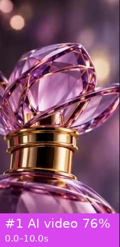
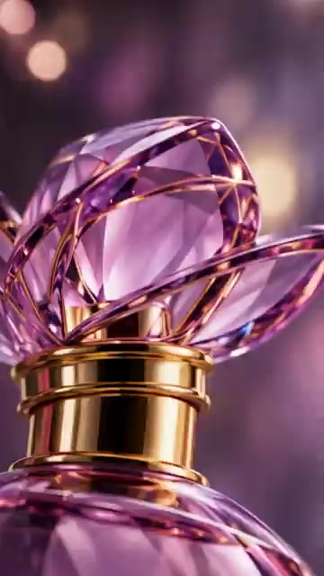
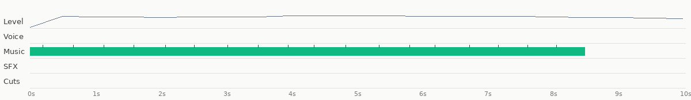
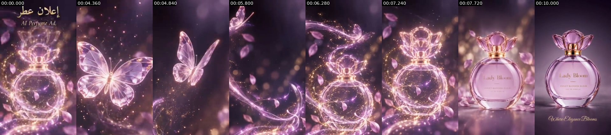

# How this video was made: 8a0fc128-360p.mp4

**In one line**: AI perfume teaser where the scent's spray transforms into crystal flower and butterflies and then reassembles as the bottle packshot.
**How it was made**: Mixed production: AI-generated video 100%

- 0:10 · vertical 9:16 · 1 shots, 10.0s each on average
- Confidence 76%, based on: tool measurements + AI assistant reviewed 1 shots
- ⚠️ 2 points are uncertain, see “Open questions”



# Part one · Breakdown: how this video is built

## What makes it work

- **The hook**: 0-1.5s: macro on the cap and atomizer firing a glittering spray
- 1.5-3s spray morphs into a crystal flower: makes an invisible scent visible
- 3-6s crystal butterflies: brand symbol in motion
- 6-8s light lines draw the bottle and it solidifies: product reveal as payoff
- 8-10s clean packshot + script tagline: brand recall

## At a glance: picture, packaging, sound

Any short video splits into three layers: the picture, what is laid on top of it (subtitles, styled text, stickers), and the sound. Remake it one layer at a time.

| Layer | In this video | How to make it | Detail |
|---|---|---|---|
| **Picture** (base) | AI-generated video 1 shot | AI in 1 generation | “Remake it yourself” |
| **Packaging** (on top) | text, subtitle, styled text | add in the editor: subtitles, styled text and stickers by the timeline | “Packaging layer” |
| **Sound** | music (128 BPM, to confirm) | music: find a track with the same tempo and mood | “Sound” |

## Content and structure

- The narrative line below comes from reading each shot; the lines were not transcribed separately, subtitle text is under “Packaging layer”

**Narrative line**

Keep this line in a remake: same order, same job at each step, with the point refilled from your own cases, numbers and material, so it is more than a change of subject.

| Time | Shots | Job | What it says |
|---|---|---|---|
| 0.0–10.0s | #1 | grab attention | Scent made visible: spray becomes flower, butterfly, then the bottle itself, ending on brand name |

## Shot list

| # | Frame | Time | What it says | Picture | Camera |
|---|---|---|---|---|---|
| 1 |  | 0:00.0 · 10.0s | grab attention: Scent made visible: spray becomes flower, bu… | One 10 s AI take: Arabic title card 'إعلان عطر / AI Perfume … | smooth move |

## Cast, scenes and props

- No cast extracted this time (needs AI image reading)

**Scenes**

| Scene | Where | When | Set / light | Shots |
|---|---|---|---|---|
| S1 | abstract dark violet bokeh space, reflective floor at end | — | lilac/gold glitter | — |

**Props / products / logos**

- Lady Bloom bottle: round crystal bottle, crystal lotus cap, gold collar

## Camera and lighting

- Visual style: Lilac and gold, crystal glass, bokeh, particle glitter, AI magical realism
- Framing: shot size medium close-up 100%; subject is the in-focus region (no face; shot size is an estimate)
- Camera: moving camera (gimbal / handheld pan) 100%; typical move push-in
- Lighting: soft frontal light (flat light). Key light frontal (from the camera side; both sides of the subject about equally bright), from below (screen / desk bounce / low source); lighting ratio about 1.3:1 (0.4 stops); soft light (wide lit-to-shadow ramp); colour temperature cool (daylight / cool-white LED); lower half of the subject is brighter: likely light from below (screen, desk bounce); background slightly soft
- (not live footage: the above describes the light in the picture, for generation prompts, not a shooting plan)
- Grade: natural (close to the original colours); normal saturation, normal contrast, normal blacks, overall cool

<details class="ref"><summary>Per-item measurements and image readings (5)</summary>

| Aspect | Item | Verdict | Sources |
|---|---|---|---|
| Framing | shot size | medium close-up | measured |
| Camera | camera support | moving camera (gimbal / handheld pan) | measured |
| Lighting | soft / hard | soft light (wide lit-to-shadow ramp) | measured |
| Lighting | colour temperature | cool (daylight / cool-white LED) | measured |
| Grade | colour grade | natural (close to the original colours) | measured |

- Note: lighting ratio, soft / hard, colour temperature and shot size are measured on the subject's pixels (the face when there is one, otherwise the in-focus region, which is an estimate); platform transcodes crush the shadows, so hardness and fill read conservative; camera angle, light source, catchlight and rim light follow the image readers. Where measurement and readers disagree, both are listed.

</details>

## Packaging layer (subtitles / styled text / stickers / sound-effect hits)

- styled text ×3 (large size, tilted, pink fill, red fill): "96", "SO", "Lady Bloom"
- text label ×3: "VIOLET BLOSSOM", "EAL DE PARFUM", "Where Elegance"

<details class="ref"><summary>text timeline (6 rows)</summary>

| Time | Kind | Text | Style | In / out | SFX |
|---|---|---|---|---|---|
| 4.50–4.60s | styled text | 96 | pink text, white outline, line height 58.6% (about 375px) | hard in / hard out | — |
| 6.60–7.30s | styled text | SO | red text, grey outline, line height 95.2% (about 609px) | hard in / fade out | — |
| 7.50–10.00s | styled text | Lady Bloom | pink text, line height 5.8% (about 37px) | hard in (bounces / changes colour midway) | — |
| 7.50–9.60s | text label | VIOLET BLOSSOM ELIXIR | pink text, line height 2.0% (about 13px) | hard in (bounces / changes colour midway) | — |
| 8.00–9.60s | text label | EAL DE PARFUM | white text, bold, line height 1.4% (about 9px) | hard in / hard out (bounces / changes colour midway) | — |
| 8.00–10.00s | text label | Where Elegance Blooms | grey text, line height 6.3% (about 41px) | slide in | — |

</details>

- Remake: import `packaging/subtitles.srt` into your editor and put in your own words; the styled version is `packaging/overlays.ass`

## Sound

**Music**

- Tempo: 128 BPM; C major; ending: ends_with_video
- Source: to confirm
- Remake: The original track leans stock library music: search a library by BPM / mood / key for a similar track, or generate a royalty-free track in a similar style with AI

**Listen to the tracks**

- music: [stems/music.wav](stems/music.wav)

<details class="ref"><summary>Sound measurements and evidence</summary>



- Loudness -26.8 dBFS, peak -5.6 dBFS
- tempo may also be 63.8/255.2 BPM; music on 84% of the duration (0.0–8.5s); section changes at 4.0s
- Music source: to confirm (stock library music 52%, AI-generated music 30%, well-known song 17%)
  - The music is a bed under the picture: in a regular video the bed usually comes from a stock library (prior)
  - Music and video end together: edited to length or custom-made (either source possible, weak evidence)
  - Nothing about this track beyond the format prior and weak cues like the ending (no source heard, no platform music tag): source to confirm; an AI-generated bed cannot be told from a library bed here
  - How to confirm: Check the music tag on the original Douyin / Xiaohongshu / TikTok post: a song title → existing track; "original sound - @creator" → uploaded by the creator (for music videos, usually an AI song)
  - How to confirm: Run it through Shazam / ACRCloud or another song-ID service: a hit means an existing song

</details>

## Open questions

- No AI listened to the soundtrack (the review covered the picture only): real voice versus TTS is inferred from the waveform; the effects were found on the separated effects track and their types are estimated from the sound. Play the stems and each effect under “Sound” to check
- music source to confirm: most likely stock library music (52%); how to check is under “Sound”

# Part two · Remake plan

Planned for **MiniMax H3 / H3 Max**: ≤15 s per call, several shots per call, takes reference video (3 clips, ≤15 s in all), ≤9 reference images, first / last frame, native sound. Name another model and the split, lengths and prompts are redone for it.

## Remake it yourself: do it in this order

Copy the method and the rhythm, not the pictures: keep what each part does and fill it with your own content and material.

This is a short AI clip (pets / spectacle / single scene). Do the steps in this order; the detail for each is in the matching subsection below.

1. **Write the content**: write yours in the same 1 steps as the original (narrative line under “Content and structure”)
2. **Generate**: 1 call (10 s), several shots each. Each shot gets one source frame for composition (subtitles erased, in `remake/refs/`), the swapped-in people, animals and products get reference images, and the prompt lists the shots in order
3. **Adapt the prompts to your model**: each unit's draft is already laid out in MiniMax H3 / H3 Max's shot, tag and audio format; refine it against the model's prompt guide before generating (or run `rea-video plan <folder> --rewrite-prompts`)
4. **Edit**: follow the order and lengths in the shot list; the original is a single 10 s take
5. **Subtitles and styled text**: timing and style under “Packaging layer”
6. **Music**: find a track at the same tempo and mood (source: to confirm, about 128 BPM, C major)
7. **Put it together and compare**: hand the shots you made to the agent; it places them on the original timeline, keeps the original where yours are missing, and renders a side-by-side comparison with the original

### AI generation

**1 generation, 10 s in total**

> ⚠️ G1: the prompts are the tool's drafts, already in MiniMax H3 / H3 Max's layout. Check them against the model's conventions and good prompts for similar shots, then put the finals into `remake/prompts.json`; `rea-video plan` then checks the format.

| Part | Shots | Time | Length | Prepare |
|---|---|---|---|---|
| G1 | #1 | 0.0–10.0s | generate 11s, trim to 10.0s | reference images |

<details class="ref"><summary>Why it is split this way</summary>

- Grouping: consecutive shots share a call where they fit, ≤10s per call, ≤4 shots; a long stretch is cut at a scene change first
- Inputs: the model also takes reference video, but its default plan is used here: one source frame per shot (subtitles erased) fixes composition, swapped-in things get their own images
- Audio: the model can generate action sound effects and ambience along with the picture
- Packaging: the styled text, text label on the generated shots is post-production packaging: keep it out of the prompts (erased from source references) and lay it back on from the packaging timeline after generation

</details>

<details><summary>G1 · shots #1 · 10.0s</summary>

- reference images: source frames of shots #1 (subtitles erased)

Draft prompt (in MiniMax H3 / H3 Max's layout; check it and put the final into remake/prompts.json before generating):

```text
integrated_multimodal_description: Generate the shots below in order in one go, hard cuts between them; each shot takes composition, size and camera from its source frame image. Vertical 9:16; soft frontal light, cool tones, background slightly soft.
[Shot 1] One 10 s AI take: Arabic title card 'إعلان عطر / AI Perfume Ad' over glowing bottle sketch, macro of crystal flower cap and gold atomizer spraying pink mist, mist swirls into a crystal flower, then crystal butterflies, light ribbons draw a wireframe bottle that solidifies into the Lady Bloom packshot with tagline 'Where Elegance Blooms'. (composition: <Picture 1>)
overall_soundscape: Only the natural sounds of the actions on screen.
non_diegetic_music: N/A
```

</details>

<details><summary>Prompt guides for MiniMax H3 / H3 Max</summary>

- https://huggingface.co/MiniMaxAI/MiniMax-H3/raw/main/docs/VIDEO_PROMPT_WRITING_GUIDE_base_en.md
- https://huggingface.co/MiniMaxAI/MiniMax-H3/raw/main/docs/VIDEO_PROMPT_WRITING_GUIDE_ref_en.md
- https://platform.minimax.io/docs/api-reference/video-generation-v2-create
- https://docs.comfy.org/tutorials/video/minimax/minimax-h3-prompt-guide.md

</details>

### Edit

- Cut in the order and lengths of the shot list
- Rhythm: 0.0 cuts per minute, 10.04s average shot; no live-action shots

## Appendix

### Shot by shot

Each shot has two parts: what is visible on screen, and how the tools infer it was made (with the basis); remake prompts last. Folded by default.

<details class="ref"><summary>#1 00:00.000–00:10.040 · AI-generated video + code / editor overlays (text labels, subtitles, styled text)</summary>



**Visible on screen** (check against the frames)
- Picture: One 10 s AI take: Arabic title card 'إعلان عطر / AI Perfume Ad' over glowing bottle sketch, macro of crystal flower cap and gold atomizer spraying pink mist, mist swirls into a crystal flower, then crystal butterflies, light ribbons draw a wireframe bottle that solidifies into the Lady Bloom packshot with tagline 'Where Elegance Blooms'.
- Camera / lighting: medium close-up; moving camera (gimbal / handheld pan); soft frontal light (flat light); key light frontal (from the camera side; both sides of the subject about equally bright); lighting ratio about 1.3:1 (0.4 stops); soft light (wide lit-to-shadow ramp)
- Text track (text/bottom): Where Elegance Blooms
- Text track (subtitle/middle): 96 / SO / Lady Bloom
- Text track (subtitle/middle): IOLET BLOSSOM ELIXIE / VIOLET BLOSSOM ELIXIR / EALBEPARIUM / EAL DE PARFUM
- [AI assistant review] Continuous morph chain impossible in camera: spray mist turns into crystal flower, then butterflies, then light trails that assemble the bottle
- [AI assistant review] Glass flower/butterfly geometry drifts frame to frame (AI temporal morphing), not stable CG meshes
- [AI assistant review] Label text on bottle resolves progressively from blur (typical AI end-frame / image-to-video)

**How it was made, as inferred by the tools** (inferred, not seen)
- Inference: AI-generated video 74%, 3D render 8%, live action 5% (fused_agent)
- Material: AI-generated
- Basis (tool measurements, not necessarily visible to the eye):
  - Photographic texture: noise σ=0.28, 104 colours, 8% flat blocks
  - Platform transcode (YouTube) has compressed the sensor noise away: noise cues no longer apply, live action vs AI rests on frame rate and picture content

- Remake: Source is AI-generated: remake it with a video model; which shots share a call and what it is fed (the source clip, keyframes or first / last frames) depend on the chosen model, see the generation units in the remake plan

</details>

### Metadata clues

- Encoder: `Google`
- platform: YouTube

### Notes

- Deterministic forensics is reliable on motion, whole-frame pan/zoom, rendered texture and 24→30 fps conversion; telling live action from AI from 3D needs image reading (a VLM or an AI assistant's review), and a look at the frames yourself.
- Platform transcoding usually strips metadata; missing metadata proves nothing.
- The full data is in `breakdown.json`; the package for models starts at `VIDEO.md`.

---

Made with [REA-VIDEO](https://github.com/JuneYaooo/rea-video) · https://github.com/JuneYaooo/rea-video
